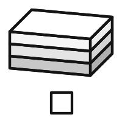
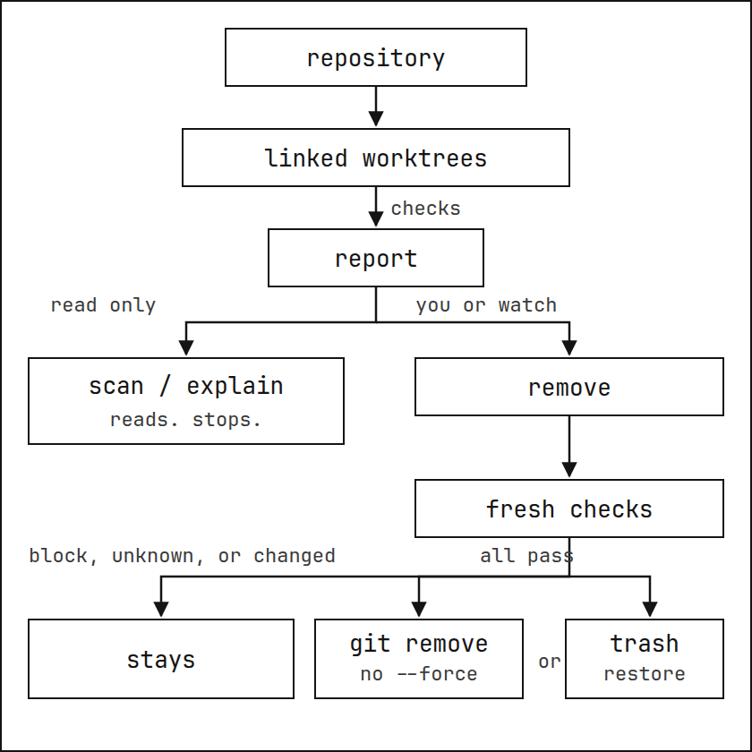

# residue

<picture>
  <source media="(prefers-color-scheme: dark)" srcset="docs/assets/logo-dark.png">
  <source media="(prefers-color-scheme: light)" srcset="docs/assets/logo.png">
  
</picture>

**Coding agents leave Git worktrees on disk; residue removes one only when every check passes.**

Website: [residue.whiteheap.com](https://residue.whiteheap.com)

<picture>
  <source media="(prefers-color-scheme: dark)" srcset="docs/assets/how-it-works-dark.png">
  <source media="(prefers-color-scheme: light)" srcset="docs/assets/how-it-works.png">
  
</picture>

A repository's linked worktrees are checked, then reported. `scan` and `explain` only read that report and stop. `remove` is separate: you run it, or `watch` chooses paths for it. From fresh checks, a block, an unknown, or a change keeps the worktree. Only when every check passes does `git worktree remove` delete it, without `--force`, after residue writes the record `restore` recreates it from; or the trash holds it for `restore`. A pass is not a guarantee, and age alone does not mean inactive.

[Install](#install) · [Inspect](#inspect-a-worktree) · [Remove](#remove-a-worktree) · [Automate](#automate-cleanup) · [Reference](#reference)

<a id="what-it-does"></a>
<a id="when-to-reach-for-it"></a>
<a id="use"></a>

## Install

<a id="prerequisites"></a>

`git` 2.36 or later, on `PATH`.

```sh
brew install whiteheap/tap/residue
```

`~/src/app` in the examples is a repository path. `PATH` is a linked worktree, not a subdirectory inside one.

Signed apt, dnf, and pacman repositories, the key fingerprint, release archives, and `cargo install --locked --git https://github.com/whiteheap/residue --tag v0.0.6` are in [Install residue](docs/installation.md).

## Inspect a worktree

`scan` and `explain` do not delete.

```sh
residue scan ~/src/app
residue explain PATH
```

A check passes, blocks, or is unknown. The report then uses one verdict:

| Verdict | Meaning |
| --- | --- |
| `candidate` | Every check passed. This is the only verdict removal will act on. It is not a promise that a later change is impossible. |
| `keep` | At least one check blocked. |
| `unknown` | A check could not be finished, and none blocked. Residue keeps the worktree. |
| `stale` | Git still lists the worktree and the directory is gone, or Git marks it prunable. Reported, not removed. Run `git worktree prune` yourself. |

Age is not a verdict. A missing or unreadable last change is `unknown`, not inactive.

<a id="its-working-if"></a>

### It's working if

This transcript is an example from the documentation, not a measurement of your machine. The directories are still there after `scan`:

```text
$ residue scan ~/src/app
residue 0.0.6 · as of 14:03:12 +02:00 · activity: lsof inspected 506 of 807 running processes

~/src/app · 4 linked worktrees · 5.6 GB
  candidate   2.1 GB  ~/src/app/.worktrees/fix-login  [fix-login]
                      branch kept · 1 local-only commit · upstream gone · changed 3 days ago
  keep        1.9 GB  ~/src/app/.worktrees/feat-search  [feat-search]
                      in use: node[4211], zsh[4198]
  keep        1.3 GB  ~/src/app/.worktrees/spike  [spike]
                      ignored: .env (1 file, 312 B) · 2 untracked
  keep        0.3 GB  ~/src/app/.worktrees/review  (detached 7954cfbb7b3a)
                      unreferenced detached HEAD

disk  41 GB free of 494 GB (8%)  (filesystem of ~/src/app)
1 candidate of 4 linked worktrees · 2.1 GB allocated · about 2.1 GB reclaimable
next: residue explain PATH  ·  residue remove PATH  ·  keep one: git worktree lock PATH
```

A removal that does not pass exits 3 and leaves the directory in place. A removal that does pass leaves the branch and a removal record: for 30 days, `residue restore` recreates the worktree at its path, on its branch and HEAD. With `--trash`, `residue restore` puts the worktree itself back, every file included, until the purge. That is not true of a delete that was already partial when residue was killed: see [What removal deletes, and what it keeps](#what-removal-deletes-and-what-it-keeps).

With no PATH, `scan` uses the current directory. A PATH inside a repository selects that repository. Any other directory is searched four levels down, without following symbolic links or crossing filesystems, and without entering hidden directories, `node_modules`, `target`, or `Library`. Linked worktrees come from Git's list. `--json` and `--idle` are in the [command reference](docs/reference.md#where-a-path-applies).

### What makes a worktree a candidate

residue runs every check below on every linked worktree. A worktree is a **candidate** only when all of them pass. One failed check keeps it (**keep**). One check residue could not complete also keeps it (**unknown**). The main checkout is never a candidate.

| Check | Keeps the worktree when |
| --- | --- |
| `identity` | The path is not the linked worktree Git lists for this repository |
| `locked` | It is locked with `git worktree lock` |
| `activity` | A process residue can see has its working directory or an open file inside it. On NetBSD, OpenBSD and DragonFly, also when no use is found (`unknown`): the probe there does not read open files, so it cannot show a worktree is unused |
| `idle` | Only with `--idle DURATION`: it changed within DURATION, for example `changed 3 hours ago (--idle 2d)` |
| `tracked_changes` | Any tracked file is staged or modified |
| `untracked` | Any untracked file or directory exists |
| `index_flags` | A tracked file is marked assume-unchanged or skip-worktree, so `git status` cannot see edits to it |
| `ignored` | Any ignored entry matches no regenerable rule ([reference](docs/reference.md#the-regenerable-list)) |
| `operation` | A rebase, merge, cherry-pick, revert or bisect is in progress |
| `private_refs` | It has per-worktree refs (`refs/worktree/`, `refs/bisect/`, `refs/rewritten/`) |
| `head` | HEAD is detached and no branch, tag or remote-tracking ref contains it |
| `layout` | It has submodules or is a sparse checkout |
| `nested_repo` | It contains another repository or checkout |
| `mount_point` | It contains a mount point |
| `contents` | residue could not read some of its entries |

Some facts never block, and residue reports each one separately instead of calling a worktree "safe": commits that are on the branch but on no remote-tracking ref, whether the branch's upstream is gone, the last change and what made it, and size. `scan` and `explain` do not fetch, so "local-only" means local-only as of the last fetch.

## Remove a worktree

A passing check is not a closed race. From the last check until Git finishes deleting, a process that opens the hidden path, or one the probe cannot see, can still write, and that write is deleted with the worktree. If residue is killed during `git worktree remove` itself, the directory may already be partial, and residue does not promise to roll that back. `--yes` skips the prompt. Use it only from the session that owns the worktree and knows the task is finished, or from a scheduled `remove --all --idle`. Without a terminal, residue deletes nothing unless you pass `--yes`.

```sh
residue remove PATH
```

### What removal deletes, and what it keeps

`residue remove` deletes the worktree directory with `git worktree remove`, without `--force`. That deletes:

- the checked-out tracked files. Every one of them is committed, because the `tracked_changes` check passed.
- the ignored entries the plan lists, with their file counts and sizes, for example `node_modules/ (41530 files, 816 MB)`. Every one of them matches a regenerable rule.

It keeps the branch, every commit, the stash, and every other worktree. residue never deletes a branch, never kills a process, and never lifts a lock it did not set. It also writes a removal record before it deletes, so `residue restore` can recreate the worktree: see [Restore a removed worktree](#restore-a-removed-worktree).

Before it deletes anything, residue prints the plan and asks you to type `yes`. The plan records what it showed you for each worktree: HEAD, the branch, the lock, the staged, modified and untracked files, the file count, size and newest modification time of every ignored entry, and the modification times of the worktree's index and HEAD reflog. Right before each removal, residue takes a new process snapshot, runs every check again, and compares. Any difference skips the worktree, and the reason names it:

```text
skipped .worktrees/big: node_modules/ changed since you confirmed (1,204 -> 1,388 files)
```

residue deletes what you saw, or nothing. With `--yes` there is no prompt, so the reason says `changed since the plan`.

Then residue moves the worktree aside with `git worktree move`, to a hidden sibling named `.NAME.residue-removing-PID`, and locks it. The move is one rename on the same filesystem; a worktree that is a mount point is skipped, never copied. After the move, nothing can reach the worktree by its old path, so residue checks once more at the new path: a new process snapshot must see nobody inside it, and the record must still match. Only then does `git worktree remove` delete it. If anything differs, residue moves the worktree back, unlocks it, and the reason ends with `it is back in place`.

The move narrows the window between the last check and the deletion; it does not close it. A program that opens the old path after the move finds nothing there, and a process that was already inside shows up in the second snapshot. What remains: from that last check until Git finishes deleting, a process that opens the hidden directory by its new name, or one the probe cannot see (another user's, or one in a container or virtual machine), can still write into it, and that write is deleted with the worktree. Git checks again for modified and untracked files before it starts deleting, but not for ignored ones.

If residue is killed between the move and the end of the deletion, the worktree stays under its hidden name and Git still lists it. The next `residue scan` lists it under `interrupted removals`, with the one command that puts it back:

```text
interrupted removals (a residue run moved these aside to delete them and stopped; if it stopped during the delete, part may be gone):
  .worktrees/.fix-login.residue-removing-4242  was .worktrees/fix-login
    put it back: git -C /Users/me/src/app worktree unlock /Users/me/src/app/.worktrees/.fix-login.residue-removing-4242 && git -C /Users/me/src/app worktree move /Users/me/src/app/.worktrees/.fix-login.residue-removing-4242 /Users/me/src/app/.worktrees/fix-login
```

If its directory is already gone, the command clears Git's record with `git worktree remove` instead. If the process that moved it still runs, the line says so: it may still be removing it. residue never removes a worktree under a hidden name, by sweep or by PATH, so nothing touches it until you recover it. A run that stopped after it wrote the removal record adds a second line, `or: residue restore RECORD`, which moves the worktree back the same way.

If stdin is not a terminal, residue does not delete anything unless you pass `--yes`. Pass `--yes` only from the session that owns the worktree and knows its task is finished, such as an agent's last step or a launcher tearing down a task, or from a scheduled `remove --all --idle` as [Run it on a schedule](#run-it-on-a-schedule) describes. Every check still runs. Without `--idle`, a session that is paused looks exactly like a finished one, so `remove --all --yes` refuses to run without it.
### Keep a worktree

```sh
git worktree lock --reason "resume on Monday" PATH
```

residue treats every lock as final. It is Git's own mechanism, so other tools respect it too.
### The trash

`residue remove --trash` moves each worktree into the trash instead of deleting it. `--idle` turns it on, so a scheduled sweep uses the trash unless you pass `--no-trash`.

```sh
residue remove --trash ~/src/app/.worktrees/fix-login
residue restore               # list the trash of the repositories at or under this directory
residue restore fix-login     # put one back
```

Each repository has its own trash, `residue-trash/` in its Git common directory: `.git/residue-trash/` in the main checkout. Each entry is a directory named after the worktree and the time it was trashed, `fix-login-20261107T040000Z/`, that holds the worktree under its own name and a record, `info`, with its original path, branch, HEAD, the time it was trashed and its size. The trash lives there because:

- a move into it is one rename on the repository's filesystem, the usual place for linked worktrees, so trashing takes no time and no extra space;
- it belongs to the repository: every worktree of the repository finds it, `git status` never shows it, and deleting the repository deletes its trash;
- the worktree stays registered with Git, and its record moves with it, so `residue restore` and the purge are plain Git commands.

A trashed worktree is locked with the reason `residue: in trash`, and `git worktree list` still shows it. Its branch stays checked out there, so `git switch` to that branch in another worktree refuses until you restore the worktree or the purge removes it. residue refuses to trash a worktree that is on another filesystem than its repository, because the move would be a copy; remove it with `--no-trash`, or keep it.

`residue restore NAME` takes the entry name, the worktree's directory name or branch when only one entry matches, or the path of an entry. It unlocks the worktree and moves it back with `git worktree move`, which updates Git's record, then drops the entry. It refuses when something exists at the original path again. A restore counts as a change, so a sweep under `--idle` does not trash the worktree again right away.

The trash does not free disk space: a trashed worktree takes all the space it took before. The purge frees it. Every `remove` run purges the trash entries older than `--keep-trash DURATION` (default `7d`) in the repositories it covers, and lists them in its plan before you confirm. The purge runs every check on each entry again, except `--idle`, since `--keep-trash` is the trash's only clock, and deletes it with `git worktree remove`, without `--force`. An entry that someone changed in the trash stays, and the run says why. A preview, or a run you do not confirm, purges nothing.

### Restore a removed worktree

Every deletion leaves a removal record: `remove`, `remove --no-trash`, a sweep, `watch`, and the trash purge. The line that reports the removal ends with the command that brings it back:

```text
removed .worktrees/fix-login (branch fix-login kept); about 812 MB reclaimable; restore: residue restore /Users/me/src/app/.git/residue-removed/fix-login-20261107T040000Z
```

```sh
residue restore               # list trash entries and removal records, newest first
residue restore fix-login     # recreate one: its name, the worktree's name or branch, or a path
residue restore --to ~/src/app/.worktrees/fix-login-2 fix-login
```

A record is a directory in `residue-removed/` in the repository's Git common directory, `fix-login-20261107T040000Z/`, with an `info` file: the original path, the branch, HEAD, the upstream, why it was removed and by which command (`remove`, a `remove --all` sweep, or `watch`), when, its size, and the ignored entries the deletion took. Beside it are copies of the worktree's HEAD reflog (`HEAD.reflog`) and its `config.worktree`, when it has them. A ref, `refs/residue/removed/fix-login-20261107T040000Z`, keeps the HEAD commit, so a deleted branch, an expired reflog or `git gc` cannot lose it. Commits that only the worktree's own HEAD reflog held, such as work committed on a detached HEAD that was then checked out away from, get a ref each under `refs/residue/reflog/fix-login-20261107T040000Z/`: `git worktree remove` deletes that reflog, and without the ref `git gc` would delete them. residue writes the record and syncs it to disk after it moves the worktree aside and before its last check (the purge, after its re-check), and writes the refs in one `git update-ref` transaction, all or none. If the record cannot be written, or the last check fails, residue moves the worktree back and deletes nothing.

`residue restore` recreates the worktree with `git worktree add`, never `--force`, and never moves an existing branch:

| The branch now | restore |
| --- | --- |
| at the recorded HEAD, or ahead of it | checks the branch out |
| rewritten, so it no longer contains the recorded HEAD | creates `BRANCH-restored` at the recorded HEAD; the branch stays as it is |
| deleted | creates it again at the recorded HEAD |
| checked out in another worktree | refuses, and names that worktree |
| none: the worktree was on a detached HEAD | restores it detached at the recorded HEAD |

It refuses when something exists at the path; `--to PATH` restores somewhere else. The tracked files come back as they were committed. The ignored files the deletion took, such as `node_modules/`, do not: restore lists them, and the project's install or build makes them again. The new worktree gets the saved HEAD reflog back, with the commits only it held. Then restore drops the record and its refs, but only once the worktree's HEAD contains the recorded HEAD and its reflog names every commit the reflog refs keep. If not, for example because the branch moved while restore ran, the record stays and restore says why.

A restored worktree is never removed again by `watch` because its branch landed: you wanted it back after it landed. `residue remove PATH`, a sweep and `watch`'s low-disk rule still can.

Every `remove` run forgets the records older than `--keep-removed DURATION` (default `30d`) in the repositories it covers, after the same confirmation: it deletes the record and its refs in one transaction, only while each ref still names the commit the record names, and never a ref residue did not write. A record residue cannot read or forget is a warning on stderr and in the JSON `errors`, and never changes the exit status. A directory with no `info` and no ref, left by a run stopped while it wrote one, is cleared once it is an hour old. A record is small: the info file and the copied reflog, usually a few kilobytes.

What `--keep-removed` can lose: forgetting a record deletes its refs, so a commit one of them was the last holder of becomes unreachable, and the next `git gc` deletes it. Usually that is nothing, because the branch still has the commits. It is not nothing for a branch deleted after the removal, such as one deleted after a squash merge, or for work only the worktree's reflog held: there the record is the last holder, and `--keep-removed` is the only grace period. Restore what you want before then, or put it on a branch. Tools that read every ref, such as `git log --all` and `git push --mirror`, see `refs/residue/removed/` and `refs/residue/reflog/`.

## Automate cleanup

Turn it on with one command:

```sh
residue service install
```

That starts `residue watch` now and at every login (launchd on macOS, systemd --user on Linux). With no ROOT it watches the usual code folders in your home folder that exist, and prints which: `~/src`, `~/code`, `~/Code`, `~/dev`, `~/Developer`, `~/projects`, `~/Projects`, `~/repos`, `~/git`, `~/github`, `~/GitHub`, `~/work`, `~/Work` and `~/workspace`. Name folders to watch only those: `residue service install ~/src`. `residue service uninstall` turns it off. One `watch` runs per user. While none is installed or running, `residue scan` at a terminal ends with a one-line reminder of this command.

Try the dry run before anything is removed:

```sh
residue watch --once --dry-run
residue service install --dry-run
```

The first prints what it would remove right now (for one folder: `residue watch --once --dry-run ~/src`); the second installs a service that only logs it. A dry run still fetches (below); add `--no-fetch` to leave the refs alone too.

<a id="reclaim-storage-automatically"></a>

### Reclaim storage automatically

`residue watch` removes in two cases only.

- **The work landed.** The upstream branch is gone in the local refs, and the worktree has not changed for `--grace` (default one hour). `watch` runs `residue remove --yes --idle --no-trash --only-if-upstream-gone`. The child reads those refs at the plan, again before the move aside, and again after the move. If the upstream is back, there is no upstream, the HEAD is detached, the upstream is local (`.`), or the ref exists but does not resolve to a commit, the worktree stays.
- **The disk is low.** Free space on that filesystem is below `--min-free` (default 10%). Worktrees unchanged for `--idle` (default two days) go, largest first, until free space is five points above the threshold. The child is `residue remove --yes --idle --no-trash` without `--only-if-upstream-gone`.

Both delete. They do not use the trash. The same run still purges that repository's trash entries older than seven days. Branches, commits, and locked worktrees stay. Each removal leaves a removal record, and its log line ends with the command that brings the worktree back, `restore: residue restore RECORD`. A worktree you restore is never removed again because its work landed; disk pressure still removes it. `scan` never starts `watch`.

To see a branch deleted on the remote, `watch` fetches: about every 30 minutes (`--fetch-every`), `git fetch --prune --no-tags` for each remote that a worktree's branch tracks. The fetch never prompts. It runs without a terminal, and SSH runs with `BatchMode=yes` unless you set your own SSH command, so a fetch that needs a password or a passphrase fails, is logged, and changes nothing. A fetch changes only remote-tracking refs and writes no `FETCH_HEAD`, so it does not reset a worktree's idle clock. It is never a reason to remove: it only refreshes the refs the checks read. `--no-fetch` turns it off; then a deleted branch counts after your own `git fetch --prune`.

Logs, linger, the five-minute free-space read, the six-hour rescan and running `service install` again are in [Automate residue](docs/automation.md#reclaim-storage-automatically).

<a id="run-it-on-a-schedule"></a>
<a id="why---idle-matters"></a>
<a id="preview-the-next-run"></a>
<a id="macos-launchd"></a>
<a id="linux-systemd"></a>
<a id="exit-status-of-a-sweep"></a>

### Run it on a schedule

A fixed-time sweep is not `watch`. It uses the trash:

```sh
residue remove --all --yes --idle 2d --keep-trash 7d ~/src
```

`remove --all --yes` is a usage error without `--idle`. `--idle` turns `--trash` on unless you pass `--no-trash`. The purge of entries older than `--keep-trash` (default 7 days) is what frees the disk. A daily sweep therefore leaves a worktree on disk until that purge. Preview with the same command without `--yes`; without a terminal, that preview removes nothing.

A paused agent often has no process in the worktree, because the harness returns to the main checkout between commands. `--idle` is the extra signal for that case. The last change is the newest of the checkout entries, the files directly in the worktree's Git directory, and the timestamp inside the newest HEAD reflog entry. It is not the mtime of `logs/HEAD`. Reads such as `git status`, `git diff`, and `git log` do not count. Lock a session that may sit without writes:

```sh
git worktree lock --reason "agent paused, resume Monday" PATH
```

The launchd plist, the systemd unit and timer, how to stop them, and the sweep's exit status are in [Automate residue](docs/automation.md#run-it-on-a-schedule).

## Reference

| Topic | Where |
| --- | --- |
| Apt, dnf, pacman, archives, `cargo install` | [Install residue](docs/installation.md) |
| PATH search, `--json` fields, exit codes, regenerable rules | [Command and configuration reference](docs/reference.md) |
| Default folders, fetching, launchd, systemd, idle clock, sweep exit status | [Automate residue](docs/automation.md) |
| Platforms, what was not run, CI scripts | [Platforms and testing](docs/platforms-and-testing.md) |

<a id="the-regenerable-list"></a>
<a id="rules"></a>
<a id="where-rules-come-from"></a>
<a id="exit-status"></a>
<a id="for-coding-agents"></a>

Exit codes and the `results[].result` values are in the [reference](docs/reference.md#exit-status). `residue remove --yes --json "$WORKTREE"`, run from outside the worktree, is there too: exit 0 means removed or trashed, exit 3 means it is still there, and diagnostics stay on stderr.

Ignored does not mean disposable. An untracked file that is not ignored always keeps the worktree. Residue never takes a regenerable rule from a file committed in the repository, or from `git -c`, `GIT_CONFIG_COUNT`, `GIT_CONFIG_PARAMETERS`, or `GIT_CONFIG`. The built-in names, the path grammar, and where a rule is stored are in the [reference](docs/reference.md#the-regenerable-list).

### Common questions

**Why does an unattended sweep need `--idle`?** A paused agent often has no process inside its worktree. Harnesses reset the shell to the main checkout between commands, so the activity check sees nothing while the session is waiting. `--idle` keeps a worktree that changed within the duration. `remove --all --yes` refuses to run without it. [Why `--idle` matters](#why---idle-matters).

**A file showed up while the prompt was waiting. Is it deleted?** No. `remove` compares a fresh record with the plan and skips the worktree, naming the difference. In 0.0.4 a file added under `node_modules/` during that wait was deleted with the worktree. From 0.0.5 that case is a skip.

**residue removed a worktree I still wanted. Can I get it back?** Yes, for 30 days: `residue restore` lists what it can bring back, and `residue restore NAME` recreates the worktree at its path, on its branch and HEAD. The log or remove line names the exact command. The ignored files the removal deleted, such as `node_modules/`, are not kept. `watch` never removes a restored worktree again because its work landed. [Restore a removed worktree](#restore-a-removed-worktree).

**`watch` removed a worktree after the upstream branch came back.** That was fixed. For a landed branch, `watch` runs `remove --only-if-upstream-gone`, and the child checks the local refs at the plan, again before the move aside, and again after the move. If the upstream is back, the worktree stays. The child does not fetch, so it judges what is in the local refs at that moment.

**Which folders does `watch` use without a ROOT?** Those of `~/src`, `~/code`, `~/Code`, `~/dev`, `~/Developer`, `~/projects`, `~/Projects`, `~/repos`, `~/git`, `~/github`, `~/GitHub`, `~/work`, `~/Work` and `~/workspace` that exist, each searched like any ROOT: four levels deep, on one filesystem, without following symbolic links. Never your home folder itself, which holds far more than code, and nothing under `Documents`, `Desktop` or `Downloads`, which macOS guards with a permission prompt. If none exists, `watch` and `service install` say so in one line and exit 2; name a folder then. `service install` writes the folders it found into the service, so the service watches the same ones at every start; run it again to pick up a folder created since.

**What does running `residue service install` again do?** It replaces the service, so it is safe to run twice. Without a ROOT, it keeps the ROOTs you named for the service it replaces; a service on the usual code folders looks for them again. Options are not kept: the ones you do not give go back to their defaults, `--dry-run` included, and it says so when the service it replaced was a dry run. `residue service status` shows what the service runs and which folders it watches.

**Does `watch` need my SSH key or password?** Only the way your own `git fetch` does. `watch` never prompts: a fetch that would ask for a password, a passphrase or a host key fails instead, is logged once, and changes nothing. A worktree is then judged on the refs it already has. Use an SSH agent or a credential helper, or pass `--no-fetch` and fetch yourself.

**`git -c residue.regenerable=...` had no effect.** That is deliberate. A rule inherited through the environment would widen what residue deletes for every child process. residue ignores it, prints a note on stderr, and lists the values in `ignored_environment_rules`. Pass `--regenerable`, or `git config --add residue.regenerable`.

**Is there an AUR package?** Not yet. Arch and Omarchy install from the pacman repository above, or from the release archive. Publishing `residue-bin` to the AUR is waiting on account registration.

## Platforms and limits

### What the activity probe can and cannot see

- **macOS**: one `lsof` snapshot of the working directories and open files of the processes your user can inspect. residue reports how many processes that covered, for example "lsof inspected 506 of 807 running processes".
- **Linux**: `/proc/*/cwd`, `/proc/*/exe` and `/proc/*/fd`, for the processes your user can read.
- **FreeBSD**: one `procstat -f` snapshot from the base system, of the working directories and open files of the processes your user can inspect. procstat is built with the running kernel. A packaged lsof is not used: in testing on FreeBSD 14 it listed processes without resolving their working directories, which would have hidden a worktree in use. A process whose working directory the kernel cannot name does not count as inspected. Every release since 0.0.5 has a FreeBSD x86_64 binary, `residue-vX.Y.Z-x86_64-unknown-freebsd.tar.gz`, and every release since 0.0.6 also has an aarch64 one, `residue-vX.Y.Z-aarch64-unknown-freebsd.tar.gz`, on the [releases page](https://github.com/whiteheap/residue/releases). Each is built from the tag's source, run and smoke-tested in a FreeBSD 14 virtual machine of its own architecture; the aarch64 machine is emulated on an x86_64 runner.
- **NetBSD, OpenBSD and DragonFly**: the base system's `ps` lists every process, then one sysctl per process asks the kernel for its working directory (`kern.proc_args.PID.cwd` on NetBSD, `kern.proc_cwd.PID` on OpenBSD, `kern.proc.cwd.PID` on DragonFly), and on NetBSD and DragonFly for its executable too. Open files are not read: a process that works elsewhere but holds a file open inside the worktree is not seen. So on these three systems residue never offers a worktree for removal on activity grounds. Activity is `in_use` when the probe finds a process inside the worktree, and `unknown` otherwise, never `not_observed`, so nothing there is a removal candidate and `remove`, `--all` and `watch` remove nothing. `scan` shows such a worktree as `unknown` with `activity unknown (partial_probe)`, its header says what the probe read ("sysctl inspected 9 of 41 running processes, working directories only, not open files"), and `explain` says why: "sysctl reads working directories only, not open files, so it cannot show that no process is using it" (NetBSD and DragonFly: "working directories and executables only"). Remove a worktree there with `git worktree remove`. `fstat` is not used: on NetBSD and OpenBSD it names an open file only by its mount point and inode ("Normally the name cannot be determined", fstat(1)), so it cannot say whether a process is inside a worktree. A process whose working directory the kernel does not name does not count as inspected, and when it names none at all, activity is `unknown`. As an ordinary user, OpenBSD names only your own processes' working directories; NetBSD and DragonFly name every process's by default.
- **illumos**: `/proc/PID/path/`, which names each process's working directory, every open file descriptor and every mapped object, the executable among them (proc(5)), for the processes your user can inspect. Not `/proc/PID/cwd`, whose readlink yields an empty string. A process whose working directory has no path there does not count as inspected. illumos has no inotify or kqueue, so a running `residue watch` acts on its five-minute timer instead of on change events.


The probe has three answers. `in_use` means a process was seen inside the worktree. `not_observed` means none of the inspected processes was inside it. `unknown` means the probe failed: its tool is missing, it timed out, it failed, or residue could not parse its output. On NetBSD, OpenBSD, DragonFly and illumos it is also `unknown` when the probe inspected no process at all. On NetBSD, OpenBSD and DragonFly it is `unknown` whenever no use is found, because a probe that does not read open files cannot show that a worktree is unused. In JSON, each worktree's `activity` is `{"state", "processes", "reason", "detail"}`: `state` is `in_use`, `not_observed` or `unknown`; `processes` lists `{"pid", "command"}` for `in_use` and is empty otherwise; and for `unknown`, `reason` is one of `probe_missing`, `timeout`, `probe_failed`, `parse_error`, `unsupported` or `partial_probe` (the probe found no use and does not read open files), and `detail` says why in words. Both are null otherwise.

`not_observed` is not proof that a worktree is idle. The probe cannot see processes owned by other users, processes inside containers or virtual machines, processes on other machines that share the disk, or a session that is closed now but that you mean to resume.

A process can also open the directory a moment after the snapshot; residue moves the worktree aside and looks again before it deletes, which narrows that gap but does not close it. That is why removal asks a human, why `--yes` belongs to the session that owns the work, and why a scheduled sweep needs `--idle`.

### Limits

- **Work landed means the local refs say so.** `scan`, `explain` and `remove` never fetch, and `watch` fetches each repository about every 30 minutes: a branch deleted on the remote counts once a fetch with prune, `watch`'s own or yours, reaches the local refs, and one that comes back counts once a fetch brings it back. An upstream counts as gone only when its remote-tracking ref is absent. A loose ref that is a dangling symbolic link reads as absent to Git and so to residue, and a `git remote rename` in progress makes its branches look gone until it finishes; `watch` scans only after the refs have been quiet for 20 seconds, at most two minutes.
- **Freed space is an estimate.** residue counts each hard-linked file once and excludes files that also have links outside the worktree (such as pnpm's store). It cannot see APFS or Btrfs clones, snapshots, or deleted files a process still holds open, so the space actually freed can be smaller.
- **residue reads every entry of every worktree it inspects.** That walk is the check behind `nested_repo`, `mount_point` and `contents`, and the sizes come from the same walk. So there is no option to skip it. On a 1.0 GB worktree with 46,572 entries (macOS, Apple silicon, warm cache), `residue explain` took 0.65 to 0.83 s, and `git worktree remove` of an identical copy took 2.7 to 3.0 s.
- **The last check is not the deletion.** residue moves a worktree aside and checks it again before Git deletes it, which leaves a window from that check to the end of the deletion. A process that opens the hidden directory by its new name, or one the probe cannot see, can write into it then, and the write is deleted with it. [What removal deletes](#what-removal-deletes-and-what-it-keeps) has the detail. A removal record brings back the committed state, not such a write. A sweep uses the trash, so what it takes by mistake stays restorable, every file included, until the purge.
- **residue only handles linked worktrees.** It does not touch package-manager stores, Docker build cache or toolchain caches. Use their own commands, which know what is safe: `pnpm store prune`, `docker builder prune`, `npm cache verify`, `go clean -cache`, `uv cache prune`.
- **Stale entries are reported, not cleaned.** For a worktree whose directory is already gone, residue reports the leftover Git metadata as `stale` and tells you to run `git worktree prune`. For an orphaned checkout whose repository is gone, residue lists it and leaves it alone.
- **residue is not a security boundary.** It runs as you, and assumes the other processes running as you are not trying to fool it.

### Tested on

The named runs are in [Platforms and testing](docs/platforms-and-testing.md). That page is the record. It is not a promise about a platform it does not name.

In short: release binaries were run on macOS, including a 0.0.6 `scan --json` beside the 0.0.5 binary, and on Ubuntu arm64. CI runs the scripts listed there on macOS, Linux x86_64 and arm64, and in FreeBSD 14, NetBSD 10, OpenBSD 7.8, and DragonFly virtual machines, as root and as an ordinary user where that page says so. OmniOS runs the smoke test and the contract and recovery checks, not the watch smoke test and not the race check, for the reasons on that page. The Intel macOS binary was built and not executed. Windows is not supported. On NetBSD, OpenBSD and DragonFly the probe does not read open files, so activity is `unknown` (`partial_probe`) unless a use is found, and `remove`, `--all` and `watch` remove nothing there. illumos reads open files.

## Where it fits

residue is a standalone command, or a login service that runs that command. It does not create worktrees and it does not merge branches.

| Tool | Use it when |
| --- | --- |
| [Claude Code](https://code.claude.com/docs/en/worktrees) | You only want the worktrees that tool created, swept and locked by that tool |
| [Worktrunk](https://worktrunk.dev) | You want to create, switch, merge, and remove worktrees, and stop processes tied to one |
| [Agentdisk](https://github.com/laaielichter/Agentdisk) | You want disk use attributed across agent tools, with a quarantine you restore from |
| residue | You want linked worktrees from any tool removed only when every check passes, with Git doing the delete and a trash on a sweep |

## Contributing

Bug reports, fixes and test reports from other platforms are welcome. [CONTRIBUTING.md](CONTRIBUTING.md) has the setup, the checks to run, and a script that builds a scratch repository covering each verdict.

## License

MIT
