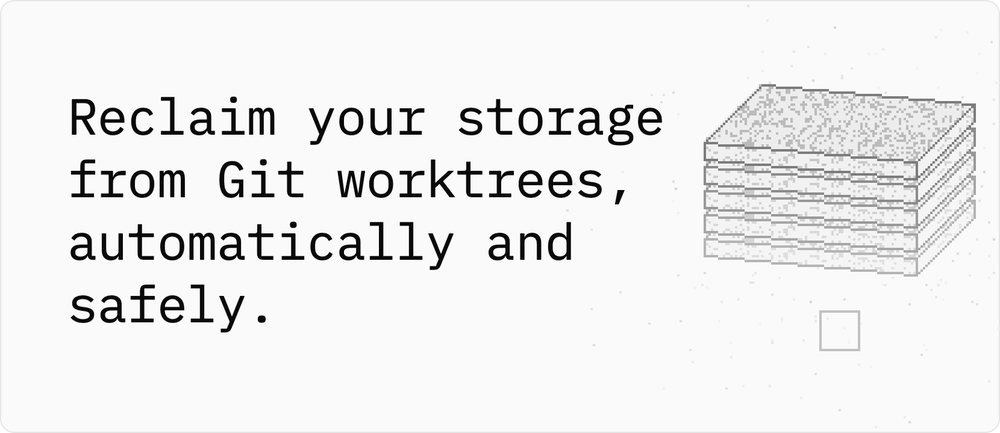

# residue

<p>
<picture>
  <source media="(prefers-color-scheme: dark)" srcset="docs/assets/hero-dark.png">
  <source media="(prefers-color-scheme: light)" srcset="docs/assets/hero.png">
  
</picture>
</p>

**residue removes a worktree only when nothing in it would be lost, whichever coding agent left it.**

```sh
curl -fsSL https://residue.whiteheap.com/install.sh | sh
```

It installs residue and, on macOS and Linux, turns on [automatic cleanup](#automate-cleanup), which deletes without asking: a worktree that passes every check, once its upstream branch is gone and it has sat unchanged for an hour, or, when free space is under 10%, once it has sat unchanged for two days. `residue restore` brings each one back for 30 days, without its ignored files. To install without it: `curl -fsSL https://residue.whiteheap.com/install.sh | sh -s -- --no-service`, or Homebrew alone: `brew install whiteheap/tap/residue`. Website: [residue.whiteheap.com](https://residue.whiteheap.com)

<p>
<picture>
  <source media="(prefers-color-scheme: dark)" srcset="docs/assets/how-it-works-dark.png">
  <source media="(prefers-color-scheme: light)" srcset="docs/assets/how-it-works.png">
  
</picture>
</p>

`scan`, `explain`, `remove`, the Mac app and `watch` all run the same checks, and only a `candidate`, where every check passed, is ever removed. `scan` and `explain` stop at the report. To delete a candidate, residue checks it again, moves it aside under a hidden name, writes its removal record, checks once more, and only then runs `git worktree remove`, never with `--force`. With `--trash`, `--idle` or the Mac app, it moves the candidate into the trash whole instead. A failed check or any change puts the worktree back. `residue restore` recreates a deleted worktree for 30 days, without its ignored files, and puts a trashed one back whole for 7 days; branches, commits and the stash always stay. A pass is not a guarantee, and age alone does not mean inactive.

[Install](#install) · [Automatic](#automate-cleanup) · [What it keeps](#what-it-keeps) · [Look first](#look-first) · [Remove](#remove-a-worktree) · [Mac app](#mac-app) · [Questions](#common-questions) · [Reference](#reference)

<a id="what-it-does"></a>
<a id="when-to-reach-for-it"></a>
<a id="use"></a>

## Install

<a id="prerequisites"></a>

residue needs `git` 2.36 or later on `PATH`. Its release builds are made for macOS 11 or later on Apple silicon and 10.12 or later on Intel, Linux on x86_64 and arm64 (static, so no libc is needed), and FreeBSD 14; [Tested on](#tested-on) says which ones were run. Windows is not supported; the install script stops there and points to WSL ([Windows and WSL](docs/installation.md#windows-and-wsl)).

The install script above uses Homebrew on macOS, the signed apt, dnf or pacman repository on Linux, or else the checksum-verified release archive, so updates arrive with your other upgrades. Running it again upgrades. [Read the script](site/public/install.sh) first if you like; [its options and how to undo it](docs/installation.md#the-install-script) are in Install residue. Homebrew alone installs residue and leaves automatic cleanup off:

```sh
brew install whiteheap/tap/residue
```

Debian 12 and Ubuntu 24.04 ship Git 2.36 or later; Ubuntu 22.04 ships 2.34, so add `ppa:git-core/ppa` there first; the install script stops before it changes anything and names that command. The apt, dnf and pacman repositories, the signing key's fingerprint, the release archives and building from source are in [Install residue](docs/installation.md). With Rust, `cargo install --locked residue` builds it from crates.io, or from a release's tag: `cargo install --locked --git https://github.com/whiteheap/residue-cli --tag v0.0.13 residue`. On a Mac, the [Mac app](#mac-app) runs the same checks in a window.

After an upgrade, automatic cleanup runs the new release on its own ([After an upgrade](docs/automation.md#after-an-upgrade)). To uninstall, run `residue service uninstall` before you remove the package: removed first, the service goes on restarting a binary that is gone. [Uninstall](docs/installation.md#uninstall) has the commands for each channel, the ones that stop the service once residue is already gone, and what residue leaves in your repositories.

## Automate cleanup

Install it as a service, and residue cleans up on its own, in two cases only:

- **The work landed.** The upstream branch is gone from the local refs, and the worktree has not changed for an hour.
- **The disk is low.** Free space is below 10%. Worktrees unchanged for two days go, largest first, until there is room again.

Each removal runs `residue remove` with every one of its checks. These removals delete: they do not use the trash. Branches, commits and locked worktrees stay. Each removal leaves a record, so for 30 days `residue restore` brings the worktree back.

See what it would remove first; when it would remove nothing, it says why:

```sh
residue watch --once --dry-run
```

Then turn it on:

```sh
residue service install
```

That starts `residue watch` now and at every login, with launchd on macOS and systemd on Linux. It watches the usual code folders in your home folder that exist, such as `~/src`, `~/code` and `~/Work`, and prints which, along with what it removes and how to preview it. If your code lives elsewhere, name its folder, which replaces the list: `residue service install ~/src`. `residue service status` shows what it runs, the folders it watches, what it freed in the last seven days, and its last pass: how many worktrees it saw, which checks keep them, and what the next pass waits for. `residue service uninstall` turns it off. `watch` runs only when you start it or install it as a service; `scan` never starts it.

A paused agent often has no process inside its worktree, because its harness returns the shell to the main checkout between commands, and an editor window may hold no file open there either. Only the time without a change keeps such a worktree: an hour once its branch is gone, two days when the disk is low. Lock one you will come back to later than that:

```sh
git worktree lock --reason "agent paused, resume Monday" PATH
```

### Reclaim storage automatically

- **The work landed.** The upstream branch is gone in the local refs, and the worktree has not changed for `--grace` (default one hour). `watch` runs `residue remove --yes --idle --no-trash --only-if-upstream-gone`, which reads those refs at the plan, again before the move aside, and again after it. If the upstream is back, there is no upstream, the HEAD is detached, the upstream is local (`.`), or the ref does not resolve to a commit, the worktree stays.
- **The disk is low.** Free space on that filesystem is below `--min-free` (default 10%). Worktrees unchanged for `--idle` (default two days) go, largest first, until free space is five points above the threshold. The child is `residue remove --yes --idle --no-trash`.

A branch gone from the remote counts as landed, so squash and rebase merges count too. residue cannot tell a merge from a branch someone deleted unmerged or renamed: either way the local branch keeps every commit, and the removal record brings the worktree back. If your host keeps merged branches, turn on its branch deletion (on GitHub, Automatically delete head branches); otherwise `watch` removes only when the disk is low.

Each removal's log line ends with the command that brings the worktree back, `restore: residue restore RECORD`. A worktree you restore is never removed again because its work landed; disk pressure still removes it. Each run also purges that repository's trash entries older than seven days. The removal records last 30 days; `residue service install --keep-removed 12w` keeps them twelve weeks ([Removal records](docs/automation.md#removal-records)).

To see a branch deleted on the remote, `watch` runs `git fetch --prune --no-tags` about every 30 minutes for each remote a worktree's branch tracks. The fetch never prompts: one that needs a password or a passphrase fails, is logged, and changes nothing. It changes only remote-tracking refs, and it is never a reason to remove. `--no-fetch` turns it off. To try the service itself first, `residue service install --dry-run` installs one that only logs what it would remove.

A `watch` that removes nothing is usually waiting: for a branch to land, or for the disk to run low. `residue service status` says which, from the record of its last pass, and says when no pass has finished for over seven hours ([Is it working?](docs/automation.md#is-it-working)).

Logs, when `watch` wakes, the six-hour rescan and running `service install` again are in [Automate residue](docs/automation.md#reclaim-storage-automatically).

<a id="why---idle-matters"></a>
<a id="preview-the-next-run"></a>
<a id="macos-launchd"></a>
<a id="linux-systemd"></a>
<a id="exit-status-of-a-sweep"></a>

### Run it on a schedule

A fixed-time sweep is not `watch`. It uses the trash:

```sh
residue remove --all --yes --idle 2d --keep-trash 7d ~/src
```

`remove --all --yes` is a usage error without `--idle`: a paused session looks exactly like a finished one, and `--idle` keeps a worktree that changed within the duration. The last change is the newest of the checkout's entries, the files directly in the worktree's Git directory and the newest HEAD reflog entry; reads such as `git status`, `git diff` and `git log` do not count. `--idle` turns `--trash` on unless you pass `--no-trash`, so the sweep frees the disk only when it purges entries older than `--keep-trash` (default 7 days). Preview with the same command without `--yes`; without a terminal, that preview removes nothing. The launchd plist, the systemd unit and timer, and the sweep's exit status are in [Automate residue](docs/automation.md#run-it-on-a-schedule).

## What it keeps

residue deletes only what its checks show you can get back.

- **Committed files and rebuildable output.** A worktree goes only when every tracked file is committed and every ignored entry matches a regenerable rule, such as `node_modules/`. An ignored `.env` keeps it, even inside `build/`. A check residue cannot finish keeps it.
- **Branches, commits and the stash stay.** residue never deletes a branch, never kills a process, and never lifts a lock it did not set. Lock a worktree to keep it.
- **What you saw, or nothing.** Right before each removal, residue runs every check again. Any change keeps the worktree, and the reason names it.
- **A record to restore from.** Every removal leaves one, `watch`'s included: for 30 days, `residue restore` recreates the worktree at its path, on its branch and HEAD. Ignored files such as `node_modules/` are not kept; the project's install makes them again.
- **A trash for the whole worktree.** With `--trash`, which `--idle` turns on, the worktree itself waits in the trash, every file included, until a later run purges it, after seven days by default.

```sh
residue restore fix-login
```

[What removal deletes, and what it keeps](#what-removal-deletes-and-what-it-keeps) · [Restore a removed worktree](#restore-a-removed-worktree) · [The trash](#the-trash)

<a id="inspect-a-worktree"></a>

## Look first

`scan` and `explain` delete nothing.

```sh
residue scan ~/src/app
```

Replace the example path `~/src/app` with your repository's path. `scan` lists each linked worktree with its size, its verdict and the reason, and every directory is still there afterwards. With no path, it uses the current directory; from your home folder, it scans the usual code folders there and says which. A folder that is not inside a repository is searched four levels down, without following symbolic links or crossing filesystems, and without entering hidden directories, `node_modules`, `target` or `Library` ([Where a PATH applies](docs/reference.md#where-a-path-applies)).

```sh
residue explain PATH
```

Replace `PATH` with a linked worktree's path, not a folder inside one, to see every check, and why it passed or failed.

| Verdict | Meaning |
| --- | --- |
| `candidate` | Every check passed. This is the only verdict removal acts on. It is not a promise that a later change is impossible. |
| `keep` | At least one check blocked. |
| `unknown` | A check could not be finished, and none blocked. residue keeps the worktree. |
| `stale` | Git still lists the worktree, but its directory is gone, or Git marks it prunable. Reported, not removed. If you moved it, `git -C MAIN worktree repair NEWPATH` reconnects it; if its disk is not mounted, mounting it brings it back ([Stale worktrees](docs/removal.md#stale-worktrees)). |

Age is not a verdict. A missing or unreadable last change is `unknown`, not inactive. `--json` gives the same report to a program ([For coding agents](docs/reference.md#for-coding-agents)).

### It's working if

`scan` ends with each worktree's verdict and the reason for it, and every directory is still there. This is 0.0.11's output on an example repository; your paths, sizes and counts differ:

```text
$ residue scan ~/src/app
residue 0.0.11 · as of 15:17:02 +02:00 · activity: lsof inspected 475 of 733 running processes

~/src/app · 4 linked worktrees · 3.2 MB
  candidate   3.2 MB  ~/src/app/.worktrees/fix-login  [fix-login]
                      branch kept · 1 local-only commit · upstream gone · changed 10 minutes ago
  keep       24.6 KB  ~/src/app/.worktrees/spike  [spike]
                      2 untracked · ignored: .env (1 file, 2 B)
  keep       16.4 KB  ~/src/app/.worktrees/review  (detached 140e7f2c2135)
                      unreferenced detached HEAD
  keep       12.3 KB  ~/src/app/.worktrees/feat-search  [feat-search]
                      in use: sleep[2993]

disk  474 GB free of 995 GB (48%), 331.2M of 338.6M inodes free  (filesystem of ~/src/app)
1 candidate of 4 linked worktrees · 3.2 MB allocated · about 3.2 MB reclaimable
next: residue explain PATH  ·  residue remove PATH  ·  keep one: git worktree lock PATH
```

### What makes a worktree a candidate

residue runs every check below on every linked worktree. A worktree is a **candidate** only when all of them pass. One failed check keeps it (**keep**). One check residue could not complete also keeps it (**unknown**). The main checkout is never a candidate. Neither is a bare repository's worktree on the branch its HEAD names, which is that layout's main checkout in all but name.

| Check | Keeps the worktree when |
| --- | --- |
| `identity` | The path is not the linked worktree Git lists for this repository |
| `locked` | It is locked with `git worktree lock` |
| `activity` | A process residue can see has its working directory or an open file inside it. On NetBSD, OpenBSD and DragonFly, also when no use is found (`unknown`): the probe there does not read open files, so it cannot show a worktree is unused |
| `idle` | Only with `--idle DURATION`: it changed within DURATION, for example `changed 3 hours ago (--idle 2d)` |
| `tracked_changes` | Any tracked file is staged or modified |
| `untracked` | Any untracked file or directory exists |
| `index_flags` | A tracked file is marked assume-unchanged or skip-worktree, so `git status` cannot see edits to it |
| `ignored` | Any ignored entry matches no regenerable rule ([reference](docs/reference.md#the-regenerable-list)) |
| `operation` | A rebase, merge, cherry-pick, revert or bisect is in progress |
| `private_refs` | It has per-worktree refs (`refs/worktree/`, `refs/bisect/`, `refs/rewritten/`) |
| `head` | HEAD is detached and no branch, tag or remote-tracking ref contains it, or the worktree is on the branch a bare repository's HEAD names |
| `layout` | It has submodules or is a sparse checkout |
| `nested_repo` | It contains a `.git` entry in any case, other than its own `.git` link: another repository or checkout, or files Git does not list |
| `mount_point` | It contains a mount point: another filesystem, or a folder or file mounted a second time, such as a bind mount ([how residue tells](docs/platforms-and-testing.md#mount-points)) |
| `contents` | residue could not read some of its entries, or one changed while it read them |

Some facts never block, and residue reports each one separately instead of calling a worktree "safe": commits that are on the branch but on no remote-tracking ref, whether the branch's upstream is gone, the last change and what made it, and size. `scan` and `explain` do not fetch, so "local-only" means local-only as of the last fetch.

## Remove a worktree

A passing check is not a closed race. From the last check until Git finishes deleting, a process that opens the hidden path, or one the probe cannot see, can still write, and that write is deleted with the worktree. If residue is killed during `git worktree remove` itself, the directory may already be partial, and residue does not promise to roll that back.

```sh
residue remove PATH
```

residue prints the plan and asks you to type `yes`. Right before each removal it takes a new process snapshot, runs every check again and compares with the plan. Any difference skips the worktree, and the reason names it:

```text
skipped .worktrees/big: node_modules/ changed since you confirmed (1,204 -> 1,388 files)
```

Then it moves the worktree aside under a hidden name, writes its removal record, checks once more, and only then runs `git worktree remove`, never with `--force`. A removal that does not pass exits 3 and leaves the directory in place. If residue is stopped partway, the next `residue scan` lists the worktree under `interrupted removals`, with the one command that puts it back. [How removal works](docs/removal.md) has each step, and the window that remains.

`--yes` skips the prompt. Use it only from the session that owns the worktree and knows its task is finished, such as an agent's last step, or from a scheduled `remove --all --idle`. Without a terminal, residue deletes nothing unless you pass `--yes`.

### What removal deletes, and what it keeps

`residue remove` deletes the worktree directory with `git worktree remove`, without `--force`. That deletes:

- the checked-out tracked files. Every one of them is committed, because the `tracked_changes` check passed.
- the ignored entries the plan lists, with their file counts and sizes, for example `node_modules/ (41530 files, 816 MB)`. Every one of them matches a regenerable rule. A directory a rule matches goes with everything in it, except an environment file such as `build/.env`, which keeps the worktree unless a rule names that file itself ([the regenerable list](docs/reference.md#the-regenerable-list)).

It keeps the branch, every commit, the stash, the Git LFS objects in the repository's shared Git directory, and every other worktree. residue never deletes a branch, never kills a process, and never lifts a lock it did not set. Before it deletes, it writes a removal record, so `residue restore` can recreate the worktree: see [Restore a removed worktree](#restore-a-removed-worktree).

### Keep a worktree

```sh
git worktree lock --reason "resume on Monday" PATH
```

residue treats every lock as final. It is Git's own mechanism, so other tools respect it too.

### The trash

`residue remove --trash` moves each worktree into the trash instead of deleting it. `--idle` turns it on, so a scheduled sweep uses the trash unless you pass `--no-trash`.

```sh
residue remove --trash ~/src/app/.worktrees/fix-login
residue restore               # list the trash of the repositories at or under this directory
residue restore fix-login     # put one back
```

A trashed worktree stays whole in its repository's `.git/residue-trash/`, locked with the reason `residue: in trash`. Git still lists it, and its branch stays checked out there, so `git switch` to that branch in another worktree refuses until you restore the worktree or the purge removes it. The trash frees no disk: every `remove` run purges the entries older than `--keep-trash` (default `7d`) in the repositories it covers, after the same checks, and lists them in its plan before you confirm. Each entry keeps the `--keep-trash` it was trashed with, and no run purges it sooner. residue refuses to trash a worktree on another filesystem than its repository, because the move would be a copy. [The trash](docs/removal.md#the-trash) has where it lives, how restore puts an entry back, and the purge.

### Restore a removed worktree

Every deletion leaves a removal record: `remove`, `remove --no-trash`, a sweep, `watch`, and the trash purge. The line that reports the removal ends with the command that brings it back, for example:

```text
removed .worktrees/fix-login (branch fix-login kept); about 812 MB reclaimable; restore: residue restore /Users/me/src/app/.git/residue-removed/fix-login-20261107T040000Z
```

```sh
residue restore               # list trash entries and removal records, newest first
residue restore fix-login     # recreate one: its name, the worktree's name or branch, or a path
residue restore --to ~/src/app/.worktrees/fix-login-2 fix-login
```

The list and a name look in the repositories at or under the current directory; run from your home folder, they look only in the usual code folders there. For an entry somewhere else, run `residue restore` inside its repository, or pass the record's path as the removal line prints it.

`residue restore` recreates the worktree with `git worktree add`, never `--force`, and never moves an existing branch:

| The branch now | restore |
| --- | --- |
| at the recorded HEAD, or ahead of it | checks the branch out |
| rewritten, so it no longer contains the recorded HEAD | creates `BRANCH-restored` at the recorded HEAD; the branch stays as it is |
| deleted | creates it again at the recorded HEAD |
| checked out in another worktree | creates `BRANCH-restored` at the recorded HEAD and names that worktree; the branch and that worktree stay as they are |
| none: the worktree was on a detached HEAD | restores it detached at the recorded HEAD |

It refuses when something exists at the path; `--to PATH` restores somewhere else. The tracked files come back as they were committed, and the worktree gets its HEAD reflog back, except in a reftable repository. The ignored files the deletion took, such as `node_modules/`, do not come back: restore lists them, and the project's install or build makes them again. `watch` never removes a restored worktree again because its branch landed; `residue remove PATH`, a sweep and `watch`'s low-disk rule still can.

No run forgets a record sooner than the `--keep-removed` it was written with, `30d` by default. Forgetting it deletes its refs, so a commit only the record kept, such as one on a branch deleted after a squash merge, goes at the next `git gc`: restore what you want before then, or put it on a branch. Tools that read every ref, such as `git log --all` and `git push --mirror`, see residue's refs under `refs/residue/`. [Removal records](docs/removal.md#removal-records) and [How restore brings a worktree back](docs/removal.md#how-restore-brings-a-worktree-back) have the rest.

### How much space it freed

A `remove` that deletes something ends with what it freed and what residue has freed on this machine so far, for example:

```text
freed about 812 MB (about 14.2 GB on this machine since 2026-10-02)
```

A move into the trash frees nothing yet, and the line says so: the space counts once a remove run purges the entry. A preview, or a run that removes nothing, prints no such line. `scan` ends with the total, the `watch` log says what each removal freed, and `residue service status` shows what automatic cleanup freed in the last seven days.

```sh
residue stats          # all time, the last 7 and 30 days, by command and by repository, and the trash
residue stats --json   # the same as residue.stats/v1
```

The numbers come from a local ledger, one line per deletion, purge, move into the trash and restore. It never leaves the machine and never decides a removal. Each size is the `reclaimable` estimate residue measured before the removal; APFS snapshots, clones and hard links can keep some of the space. [The ledger](docs/removal.md#the-ledger) has where it lives and what it holds.

## Mac app

The Mac app is residue in a window. It lists the linked worktrees under your code folders with their size and verdict, moves the ones that can go to the trash, restores them, and turns automatic cleanup on or off. Every check and removal comes from the residue inside it, nothing moves until you confirm, and automatic cleanup deletes without the trash.

<p>

</p>

The screenshot shows example data. Download [residue-macos.dmg](https://residue.whiteheap.com/download/macos), open it, and drag residue to Applications. It needs macOS 13 or later, on Apple silicon or Intel. It is not notarized yet, so macOS blocks it the first time you open it: open **System Settings > Privacy & Security** and click **Open Anyway**, as [First launch](https://github.com/whiteheap/residue-ui#first-launch) shows. The app is its own project, [residue-ui](https://github.com/whiteheap/residue-ui), whose README has the [Screens](https://github.com/whiteheap/residue-ui#screens), [What the app runs](https://github.com/whiteheap/residue-ui#what-the-app-runs), [Check a download](https://github.com/whiteheap/residue-ui#check-a-download) and [Uninstall](https://github.com/whiteheap/residue-ui#uninstall).

## Where it fits

residue is a standalone command, or a login service that runs that command. It does not create worktrees and it does not merge branches.

| Tool | Use it when |
| --- | --- |
| [Claude Code](https://code.claude.com/docs/en/worktrees) | You only want the worktrees that tool created, swept and locked by that tool |
| [Codex app](https://learn.chatgpt.com/docs/environments/git-worktrees) | You want the worktrees Codex manages kept to the newest 15, with a snapshot saved before each one is deleted |
| [Cursor](https://cursor.com/docs/configuration/worktrees) | You want the worktrees on the machine kept to the newest 25 (`cursor.worktreeMaxCount`), the oldest removed first |
| [Worktrunk](https://worktrunk.dev) | You want to create, switch, merge, and remove worktrees, and stop processes tied to one |
| residue | You want linked worktrees from any tool removed only when every check passes, with Git doing the delete and a trash on a sweep |

Codex and Cursor decide by age and count. residue decides by what is in a worktree, whichever tool made it, and never deletes a branch.

<a id="platforms-and-limits"></a>

## Before you remove anything

residue deletes directories. Start with `scan` and `explain`, and read the limits below before you remove a worktree or turn on the service. The activity check cannot see every process or a paused session, and a write can still land after the last check. Reclaimable space is an estimate. residue runs as you; it is not a security boundary between users.

### What the activity probe can and cannot see

| System | What the probe reads |
| --- | --- |
| macOS | One `lsof` snapshot of the working directories and open files of the processes your user can inspect |
| Linux | `/proc/*/cwd`, `/proc/*/exe`, `/proc/*/fd` and `/proc/*/maps` of the processes your user can read; `maps` shows a native module in `node_modules` that a process started elsewhere loaded |
| FreeBSD | Each process's working directory, executable, open files and mapped files, from the kernel (`kern.proc.filedesc`, `kern.proc.vmmap`), for the processes your user can inspect |
| illumos | `/proc/PID/path/`: each process's working directory, open files and mapped objects |
| NetBSD, OpenBSD, DragonFly | Working directories only, and on NetBSD and DragonFly executables too; not open files |

A process residue could not read does not count as inspected, and the header says how many the probe covered, for example `lsof inspected 475 of 733 running processes`. The probe answers `in_use`, `not_observed`, or `unknown` when it failed, timed out or could not parse what it read. On macOS, residue also lists every process before lsof runs: a running process of yours that lsof did not list, or whose files it could not read, as when residue runs in a sandbox that lets it inspect only its own processes, makes activity `unknown` (`probe_failed`), and the reason names it. Run residue outside that sandbox to judge the worktree. Where residue runs inside a container (a PID namespace of its own), in a user namespace of its own (toolbx, distrobox) or under a `/proc` mounted with `hidepid` on Linux, in a jail, or beside jails it may not see into (`security.bsd.see_jail_proc` at 0) on FreeBSD, or in a non-global zone on illumos, it cannot see every process of yours, so a worktree with no use found is `unknown` (`hidden_processes`), and `remove`, `--all` and `watch` remove nothing there; a use it does see is still `in_use`. Run residue on the host to judge such a worktree. A WSL distribution runs in a PID namespace of its own too, but it holds your whole Linux session, so there, once residue sees WSL's `/init` in its `/proc`, it is judged as on any Linux. On Linux and FreeBSD, a running process of yours that the kernel will not show residue makes activity `unknown` (`probe_failed`), and the reason says which: one started with another of your groups, as a `newgrp` or `sg` shell is, one a container runs as your user with another group (`docker run --user UID:GID`), or one a sandbox around residue refuses (Landlock). That is by design: residue cannot see whether such a process uses a worktree. On NetBSD, OpenBSD and DragonFly, a probe that does not read open files cannot show that a worktree is unused, so activity there is `unknown` (`partial_probe`) unless a use is found, and `remove`, `--all` and `watch` remove nothing. Each probe names a path whole only below a length: 1,004 bytes on macOS, 4,096 on Linux and 1,024 elsewhere. A worktree that holds a path that long, here or where residue would delete it, is `unknown` (`long_path`), so residue keeps it.

`not_observed` is not proof that a worktree is idle. The probe cannot see processes owned by other users, processes of yours that the kernel shows only to root, such as ssh-agent or, on Linux, one holding a capability you lack, such as systemd's user manager, processes inside containers or virtual machines, processes on other machines that share the disk, on WSL a process in another distribution or a Windows program using the worktree through `\\wsl$`, or a session that is closed now but that you mean to resume. A process can also open the directory a moment after the snapshot; residue moves the worktree aside and looks again before it deletes, which narrows that gap but does not close it. That is why removal asks a human, why `--yes` belongs to the session that owns the work, and why a scheduled sweep needs `--idle`. [The activity probe on each platform](docs/platforms-and-testing.md#the-activity-probe-on-each-platform) has the detail and the JSON.

### Limits

- **Work landed means the local refs say so.** `scan`, `explain` and `remove` never fetch, and `watch` fetches each repository about every 30 minutes: a branch deleted on the remote counts once a fetch with prune, `watch`'s own or yours, reaches the local refs, and one that comes back counts once a fetch brings it back. An upstream counts as gone only when its remote-tracking ref is absent. A loose ref that is a dangling symbolic link reads as absent to Git and so to residue, and a `git remote rename` in progress makes its branches look gone until it finishes; `watch` scans only after the refs have been quiet for 20 seconds, at most two minutes.
- **Freed space is an estimate.** residue counts each hard-linked file once and leaves out files that also have links outside the worktree, such as pnpm's store. It cannot see APFS or Btrfs clones, snapshots, or deleted files a process still holds open, so the space actually freed can be smaller.
- **residue reads every entry of every worktree it inspects.** That walk is the check behind `nested_repo`, `mount_point` and `contents`, and the sizes come from it, so there is no option to skip it. The walk opens each folder from the one above it and never through a symbolic link: a folder that becomes a link or another folder before residue opens it makes `contents` `unknown`. On NetBSD, OpenBSD and DragonFly, and on macOS 12 and earlier, every folder above the worktree must be readable, not only searchable, or `contents` is `unknown`. On a 1.0 GB worktree with 46,572 entries (macOS, Apple silicon, warm cache), `residue explain` took 0.65 to 0.83 s, and `git worktree remove` of an identical copy took 2.7 to 3.0 s.
- **The last check is not the deletion.** The window from that check to the end of Git's delete is in [Remove a worktree](#remove-a-worktree). A removal record brings back the committed state, not a write made in that window. A sweep uses the trash, so what it takes by mistake stays restorable, every file included, until the purge.
- **A removal and a restore wait for each other on one machine only.** Each run holds the trash entry or removal record it acts on with flock(2), and so does the Git it starts. A process on another machine that shares the disk does not see that hold. On a filesystem with no flock(2), such as some network mounts, residue removes and restores nothing there and says why ([Removal records](docs/removal.md#removal-records)).
- **A synced folder syncs the removal.** In a folder that iCloud Drive, Dropbox or OneDrive syncs, a removal deletes the worktree on every device, and the probe cannot see the processes on the other devices. Keep worktrees out of synced folders, or lock them.
- **residue only handles linked worktrees.** It does not touch package-manager stores, Docker build cache or toolchain caches. Use their own commands, which know what is safe: `pnpm store prune`, `docker builder prune`, `npm cache verify`, `go clean -cache`, `uv cache prune`.
- **Stale entries are reported, not cleaned.** For a worktree whose directory is gone, residue names what brings the directory back, and no command that clears Git's record of it, since that drops the worktree's HEAD and reflog. `git gc` clears that record on its own, 3 months by default after the worktree's index last changed ([Stale worktrees](docs/removal.md#stale-worktrees)). An orphaned checkout whose repository is gone is listed and left alone.
- **residue is not a security boundary.** It runs as you, and assumes the other processes running as you are not trying to fool it.

### Tested on

The named runs are in [Platforms and testing](docs/platforms-and-testing.md). That page is the record. It is not a promise about a platform it does not name.

In short: CI runs the scripts listed there on every push, on macOS, Ubuntu 24.04 and 26.04 (x86_64 and arm64), and in FreeBSD 14, NetBSD 10, OpenBSD 7.8 and DragonFly 6.4 virtual machines, as root and as an ordinary user; an OmniOS (illumos) virtual machine runs the smoke test and the contract and recovery checks. The newest release binary run by hand is 0.0.11 on macOS 26.3.1, Apple silicon; on Linux it is 0.0.5, on Ubuntu 24.04 arm64. The Intel macOS binary was built and not executed. Windows is not supported.

## Common questions

**Why not `git worktree remove` or `git worktree prune`?** `prune` frees no space: it only drops Git's record of a worktree whose directory is already gone. `remove` refuses modified and untracked files, but deletes ignored ones such as `.env` without asking. It does not check whether a process is using the worktree, or whether a detached HEAD holds commits no branch has. residue runs those checks on every worktree, leaves a removal record, and then lets `git worktree remove` do the delete.

**Does it phone home?** No. The ledger, the removal records and the logs stay on the machine. The only network traffic is `watch`'s `git fetch`, about every 30 minutes for each remote a worktree's branch tracks, and `--no-fetch` turns it off. Between passes, `watch` sleeps until a repository's remote refs change or a timer comes due, and reads free space every five minutes.

**Why does an unattended sweep need `--idle`?** A paused agent often has no process inside its worktree. Harnesses reset the shell to the main checkout between commands, so the activity check sees nothing while the session is waiting. `--idle` keeps a worktree that changed within the duration, and `remove --all --yes` refuses to run without it ([Run it on a schedule](#run-it-on-a-schedule)).

**A file shows up while the prompt is waiting. Is it deleted?** No. `remove` compares a fresh record with the plan and skips the worktree, naming the difference.

**residue removed a worktree I still wanted. Can I get it back?** Yes, for 30 days unless you set `--keep-removed`: `residue restore` lists what it can bring back, and `residue restore NAME` recreates the worktree at its path, on its branch and HEAD. The log or remove line names the exact command. The ignored files the removal deleted, such as `node_modules/`, are not kept. `watch` never removes a restored worktree again because its work landed ([Restore a removed worktree](#restore-a-removed-worktree)).

**What if the upstream branch comes back before `watch` removes the worktree?** The worktree stays. For a landed branch, `watch` runs `remove --only-if-upstream-gone`, which checks the local refs at the plan, again before the move aside, and again after it. It does not fetch, so it judges what the local refs say at that moment.

**Which folders does `watch` use without a ROOT?** Those of `~/src`, `~/code`, `~/Code`, `~/dev`, `~/Developer`, `~/projects`, `~/Projects`, `~/repos`, `~/git`, `~/github`, `~/GitHub`, `~/work`, `~/Work` and `~/workspace` that exist, each searched like any ROOT: four levels deep, on one filesystem, without following symbolic links. Never your home folder itself, which holds far more than code, and nothing under `Documents`, `Desktop` or `Downloads`, which macOS guards with a permission prompt. If none exists, `watch` and `service install` say so in one line and exit 2; name a folder then. `service install` writes the folders it found into the service, so the service watches the same ones at every start; run it again to pick up a folder created since.

**What does running `residue service install` again do?** It replaces the service, so it is safe to run twice. Without a ROOT, it keeps the ROOTs you named for the service it replaces; a service on the usual code folders looks for them again. Options are not kept: the ones you do not give go back to their defaults, `--dry-run` included, and it says so when the service it replaced was a dry run. `residue service status` shows what the service runs and which folders it watches.

**Does `watch` need my SSH key or password?** Only the way your own `git fetch` does. `watch` never prompts: a fetch that would ask for a password, a passphrase or a host key fails instead, is logged once, and changes nothing. A worktree is then judged on the refs it already has. Use an SSH agent or a credential helper, or pass `--no-fetch` and fetch yourself.

**`git -c residue.regenerable=...` has no effect.** That is deliberate. A rule inherited through the environment would widen what residue deletes for every child process. residue ignores it, prints a note on stderr, and lists the values in `ignored_environment_rules`. Pass `--regenerable`, or `git config --add residue.regenerable`.

**Is there an AUR package?** Not yet. Arch and Omarchy install from the [pacman repository](docs/installation.md#arch-linux-omarchy-and-other-arch-based-systems), or from the release archive.

## Reference

| Topic | Where |
| --- | --- |
| The install script, apt, dnf, pacman, archives, `cargo install`, uninstall | [Install residue](docs/installation.md) |
| PATH search, `--json` fields, exit codes, regenerable rules | [Command and configuration reference](docs/reference.md) |
| The plan, the move aside, interrupted removals, the trash, removal records, restore | [How removal works](docs/removal.md) |
| `residue stats`, the ledger and its JSON | [Stats](docs/reference.md#stats) |
| Default folders, fetching, launchd, systemd, idle clock, sweep exit status | [Automate residue](docs/automation.md) |
| Platforms, the probe on each one, what was not run, CI scripts | [Platforms and testing](docs/platforms-and-testing.md) |

<a id="the-regenerable-list"></a>
<a id="rules"></a>
<a id="where-rules-come-from"></a>
<a id="exit-status"></a>
<a id="for-coding-agents"></a>

Exit codes and the `results[].result` values are in the [reference](docs/reference.md#exit-status). `residue remove --yes --json "$WORKTREE"`, run from outside the worktree, is there too: exit 0 means removed or trashed, exit 3 means it is still there or an expired trash entry of its repository could not be purged (`results[].result` says which), and diagnostics stay on stderr. The [residue skill](skills/residue/SKILL.md) gives Claude Code, Codex and other agents these steps: `npx skills add whiteheap/residue-cli --skill residue -g`. `residue --help` lists every command and option.

Ignored does not mean disposable. An untracked file that is not ignored always keeps the worktree. residue never takes a regenerable rule from a file committed in the repository, or from `git -c`, `GIT_CONFIG_COUNT`, `GIT_CONFIG_PARAMETERS`, or `GIT_CONFIG`. The built-in names, the path grammar, and where a rule is stored are in the [reference](docs/reference.md#the-regenerable-list).

## Contributing

Bug reports, fixes and test reports from other platforms are welcome. [CONTRIBUTING.md](CONTRIBUTING.md) has the setup, the checks to run, and a script that builds a scratch repository covering each verdict.

## Security

For a bug that could delete valuable data, follow [SECURITY.md](SECURITY.md) and report it privately. Do not file a public issue.

## License

MIT, in [LICENSE](LICENSE).
